# Namma Space System Architecture

> **Techfest IIT Bombay 2026-27 | Competition Architecture Document**

---

## 1. Executive Summary & Problem Statement

Namma Space transforms ordinary smartphone videos of complex indoor spaces into an interactive, zero-install 3D web experience running in any modern browser. Users can walk through spaces in first person, search for Points of Interest (POIs) such as "Meeting Room 4" or "3-seater sofas", and receive obstacle-aware, turn-by-turn guidance along an optimal floor path.

### Why We Are Changing Direction (Round 1 → Round 2/3 Evolution)
In Round 1, the system utilized **3D Gaussian Splatting (3DGS)** as the primary representation. While 3DGS produces visually compelling views directly along the captured camera trajectory:
1. **Severe Degradation Off-Path**: Moving even 0.5 meters away from the training path reveals needle-like splat floaters, perspective warping, and haze.
2. **Absence of Collision Geometry**: 3DGS is an unstructured cloud of probabilistic ellipsoids. It provides no solid floor plane, no wall collisions, and no boundary meshes for real-time physics or collision clamping.
3. **Heavy Compute & File Footprint**: A 7,000-iteration splat produces 30–60 MB binary files that require high-spec WebGL memory buffers, risking browser crashes on mid-tier mobile and laptop devices.

### The New Hybrid Core (Matterport / Google Street View Model)
The upgraded pipeline decouples the experience into three dedicated architectural layers:
```
┌──────────────────────────────────────────────────────────────────────────┐
│                             VISUAL LAYER                                 │
│  • High-resolution Equirectangular Panorama Nodes (4096x2048 + 1024 LOD) │
│  • Captured / warped along the floor trajectory at 2–3 m spacing         │
│  • Pure visual crispness at 60 FPS in any browser                        │
└────────────────────────────────────┬─────────────────────────────────────┘
                                     │
┌────────────────────────────────────▼─────────────────────────────────────┐
│                            GEOMETRY LAYER                                │
│  • Metric Depth-Proxy Mesh (proxy.glb, < 50k triangles, < 5 MB)           │
│  • Open3D TSDF Fusion from predicted panoramic depth maps                │
│  • Powers projective travel transitions, Dollhouse view, and collisions  │
└────────────────────────────────────┬─────────────────────────────────────┘
                                     │
┌────────────────────────────────────▼─────────────────────────────────────┐
│                           NAVIGATION LAYER                               │
│  • Floor-aligned 2D Occupancy Grid (navgrid.json @ 5 cm resolution)      │
│  • 3D Navigation Mesh (navmesh.glb) for Three.js three-pathfinding       │
│  • A* / Theta* with path smoothing & dynamic obstacle avoidance          │
└──────────────────────────────────────────────────────────────────────────┘
```
*Note: 3DGS remains preserved as an optional "Photoreal Mode" tab.*

---

## 2. Repo Audit: Baseline Components (Round 1 Deliverable)

| File / Component | Purpose in Baseline | Status & Upgrade Plan |
|---|---|---|
| `reconstruction/extract_frames.py` | Extracts frames from video with blur filtering | Integrated into `pipeline.stages.extract` with configurable FPS & blur threshold in `config.yaml`. |
| `reconstruction/run_pipeline.py` | Monolithic script orchestrating COLMAP, mesh, and 3DGS | Modularized into `pipeline.run` CLI supporting cached, individual stages. |
| `reconstruction/build_photosphere_tour.py` | Clusters camera centers, stitches panoramas via `cv2.Stitcher` | Upgraded to `pipeline.stages.panos`: pose-guided equirectangular spherical warping with multi-band blending. |
| `reconstruction/build_occupancy_grid.py` | Downward raycasting on bounding box GLB | Replaced with height-sliced (0.2m–1.8m) proxy mesh projection, morphological opening, and agent inflation. |
| `reconstruction/export_web.py` | Converts PLY to GLB and SPLAT | Integrated into `pipeline.stages.export` generating standard `out/tour.json` contracts. |
| `backend/main.py` & `routers/` | FastAPI REST endpoints for scenes, POIs, and A* | Serves new `tour.json`, `proxy.glb`, `navmesh.glb`, and `navgrid.json` schemas. |
| `backend/navigation/astar.py` | 8-directional A* on NumPy 2D array | Enhanced with Theta* path smoothing and line-of-sight checks. |
| `frontend/src/components/Viewer3D.jsx` | React Three Fiber 3D viewer | Extended with projective travel transitions, navmesh-constrained free roam, and minimap. |
| `frontend/src/components/PhotosphereTour.jsx` | Inverted sphere panorama with navigation pucks | Upgraded with SPHR projective texture transition shader. |

---

## 3. Data Contracts & Standard Schemas

All pipeline outputs and backend responses strictly adhere to the following contracts:
- **Coordinate Convention**: Right-handed, **Y-Up**, **metres**, with floor aligned at **$y = 0.0$**.

### 3.1 Tour Manifest (`out/tour.json`)
```json
{
  "meta": {
    "units": "m",
    "up": "Y",
    "floor_y": 0.0,
    "scale_method": "reference"
  },
  "nodes": [
    {
      "id": "n001",
      "position": [0.0, 1.65, -1.5],
      "rotation": [0.0, 0.0, 0.0, 1.0],
      "name": "Entrance Foyer",
      "pano": {
        "type": "equirect",
        "url": "panos/n001.jpg",
        "thumb_url": "panos/n001_thumb.jpg",
        "depth_url": "depth/n001.png"
      },
      "neighbors": ["n002"]
    }
  ],
  "proxy_mesh": "mesh/proxy.glb",
  "navmesh": "mesh/navmesh.glb",
  "navgrid": "nav/navgrid.json"
}
```

### 3.2 Navigation Grid (`out/nav/navgrid.json`)
```json
{
  "resolution_m": 0.05,
  "origin": [-6.5, -8.2],
  "width": 260,
  "height": 340,
  "data": "RLE_OR_BASE64_ENCODED_UINT8",
  "inflation_m": 0.3,
  "floor_y": 0.0
}
```
*Cell state encoding: `0` = Free (walkable), `1` = Obstacle (wall/furniture), `2` = Unknown (unobserved).*

### 3.3 Points of Interest (`out/pois.json`)
```json
[
  {
    "id": "poi_01",
    "name": "Executive Desk",
    "category": "Furniture",
    "aliases": ["workstation", "office table", "desk"],
    "position": [1.45, 0.75, -3.2],
    "node_id": "n002",
    "source": "manual"
  }
]
```

---

## 4. Milestone Roadmap & Implementation Stages

```mermaid
flowchart LR
    M0["M0: Architecture & Unified Pipeline CLI"] --> M1["M1: Pose Backend (COLMAP / VGGT)"]
    M1 --> M2["M2: RANSAC Floor Plane Alignment (y=0)"]
    M2 --> M3["M3: Equirect Panorama Nodes & Multi-Band Blending"]
    M3 --> M4["M4: PanoDepth & Open3D TSDF Proxy Mesh"]
    M4 --> M5["M5: Navgrid & Navmesh (A* / Theta*)"]
    M5 --> M6["M6: Web Viewer (Projective Transitions & Free-Roam)"]
    M6 --> M7["M7: Search, POI Authoring & Path Guidance"]
    M7 --> M8["M8: Real-time Minimap Overlay"]
    M8 --> M9["M9/M10: Capture SOP, Live Preview & AR Relocalization"]
```



- **M0**: Unified entry point `python -m pipeline.run` with modular stages, `config.yaml`, and baseline preservation.
- **M1**: `PoseBackend` abstraction interface with COLMAP and feed-forward windowed pose estimation.
- **M2**: RANSAC plane fitting to align floor normal strictly to $+Y$ and translate floor to $y = 0$.
- **M3**: Evenly spaced vantage nodes (2–3 m), equirectangular spherical reprojection, and multi-band blending.
- **M4**: Depth prediction via `PanoDepth`, TSDF fusion, decimation to $< 50\text{k}$ triangles, export `proxy.glb`.
- **M5**: 5 cm obstacle slicing ($0.2\text{m} \le y \le 1.8\text{m}$), morphological cleaning, agent inflation ($0.3\text{m}$), navmesh glTF export.
- **M6**: React Three Fiber projective travel transition (SPHR technique) + constrained free-roam via `three-pathfinding`.
- **M7**: Fuzzy POI search (Fuse.js), 3D floor ribbon rendering, animated walkthrough camera.
- **M8**: Real-time GTA-style canvas minimap with player orientation arrow.
- **M9/M10**: On-site capture SOP, live scanner coverage feedback, and AR phone navigation relocalization.
